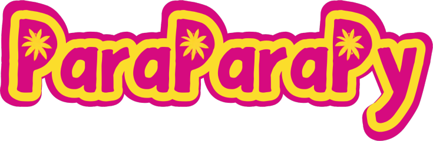

<p align="center"></p>

# ParaParaPy

A desktop Para Para dance game: a webcam tracks the player's upper body and
scores each move against a choreographed routine. See [PLAN.md](PLAN.md) for
the design and roadmap, and [CHANGELOG.md](CHANGELOG.md) for progress.

## Setup

Requires [uv](https://docs.astral.sh/uv/) and Python 3.13.

```sh
uv sync
uv run pytest
```

## Capture debug view

```sh
uv run parapara-capture-debug            # --help for options (--model lite, ...)
```

On first run it downloads ~15 MB of MediaPipe pose models to
`~/Library/Caches/parapara/models`. macOS will ask for camera access for your
terminal or IDE. Cyan = dancer's left, orange = dancer's right; `M` toggles
the mirrored view, `Esc` quits.

## Capture benchmark

```sh
uv run parapara-capture-bench            # ~1 min: dance in front of the camera
```

Shows the live camera view while it runs the full and lite pose models, then
writes a comparison to
`logs/capture-bench-*.json`. `Esc` stops early. A version without a window:
`uv run python -m parapara.diagnostics.bench`.

## Guided recorder

```sh
uv run parapara-record                   # --bpm 100 for a slower metronome
```

Walks you through calibration poses and one clip per building block, with a
guide figure and a metronome. It is **hands-free**, so you can stand back:
each clip starts once you are in position and have watched the move, is
checked (you and your hips in the picture) and then kept, or redone with the
reason shown. Fullscreen with large text (`+` / `-`, `F` window); `S` skips a
clip, `Esc` quits, `--manual` uses keys instead. Clips are saved (landmarks
only, no images) to `recordings/<date-time>/`.

## Latency calibration test

```sh
uv run parapara-latency-test             # --rounds 6 --claps 8,16
```

Runs the game's "clap to the beat" calibration several times in a row,
hands-free (stand back; it starts after the position check and closes by
itself), alternating 8 and 16 claps. Every round, with each clap's timing, is
logged to `logs/latency-test-<date-time>.json` to check how consistent the
measurement is.

## Pose analysis / recalibration

```sh
uv run parapara-analyze                  # latest session in recordings/, or pass a path
```

Compares the recorded clips with the block library (danced vs. target arm
directions, best lag, calibration values) and writes `analysis.json` into the
session folder. Use it to recalibrate `src/parapara/routine/library.py`. If
the session has neutral-pose and T-pose clips it also saves the player
calibration (`calibration.json`).

```sh
uv run parapara-tune-filters             # re-tune the smoothing filters on a session
```

## Play

```sh
uv run parapara-play                     # or simply: uv run parapara
```

New player? Read the **[player guide](docs/how-to-play.md)**.

Pick a song and routine (Up/Down, Left/Right, Enter). The first time, the
game calibrates your body (position check, neutral pose, T-pose) and your
latency (clap on 8 clicks); both are remembered (B / L in the menu redo
them). Dance with the demo dancer on the left while your mirrored camera view
is on the right. Esc ends a song early. Results are saved to `logs/` and the
play to `recordings/` (inspect with `parapara-score` / `parapara-analyze`).

New to Para Para? Press `T` in the menu to **learn the moves**: the demo
dancer shows each move slowly with metronome clicks (Left/Right next move,
Up/Down speed). While playing, the next move is shown as a small picture
at the dancer's top right; a dot slides into the ring on its left
when the move starts.

The first time the game (or the recorder) starts, it shows a privacy and
licence notice before the camera starts: camera images stay on your computer,
Google MediaPipe sends usage statistics (no images), and each play is kept
as body positions (no images) in `recordings/`. `P` in the menu shows it
again, `C` shows the credits (full attributions: [CREDITS.md](CREDITS.md)).

Both calibrations run before the first song each time the game starts and
are kept for the songs that follow (`B` / `L` redo them). Don't skip the
latency one: without it the grades are late and unfair (`S` reuses the last
saved value). The music starts as soon as you pick a song; 4, 3, 2, 1 is
counted above the dancer into the first move (`--count-in N`).

The game opens fullscreen with large text so it can be read from where you
dance: `+` / `-` change the text size (remembered), `F` toggles fullscreen,
`M` mirrors the camera. `--window` starts in a window and `--text-scale 2.4`
sets the text size from the command line.

## Watch a routine

```sh
uv run parapara-preview                              # first song, its easy routine
uv run parapara-preview defrini-lets-go-to-a-rave --routine normal --clicks
```

The demo dancer performs the routine to the song (mirrored, so you can follow
along), with the count, the current move and a next-move card. Space pauses,
Left/Right jump a bar, R switches routine, C toggles metronome clicks.

## Routines

```sh
uv run parapara-routines generate        # easy/normal/hard routines for every song missing them
uv run parapara-routines list            # songs and their routines
uv run parapara-routines blocks          # the moves you can use
uv run parapara-routines template --song <id> -o mine.json   # start your own routine
uv run parapara-routines check mine.json --song <id>         # validate it
uv run parapara-routines add mine.json --song <id>           # install it
```

Routines are generated automatically when a song is fetched or imported, and
stored next to the song (`<song folder>/routines/`). A routine is a list of
32-count phrases, each a list of move names; every phrase needs all five
kinds of move and ends with a flick + clap.

## Scoring recorded clips

```sh
uv run parapara-score                    # latest session; --latency-ms N or --auto-latency
```

Runs the block clips through the real scoring engine (grades, accuracy,
combo, flow, posture) and writes `score.json` into the session folder.

## Songs

```sh
uv run parapara-fetch-demo-songs         # the 4 CC BY demo tracks -> assets/songs/ (git-ignored)
uv run parapara-beatmap assets/songs/<id> --audio track.ogg   # detect a new track's beat map
uv run parapara-beatcheck assets/songs/<id>                   # verify it by ear, then save
```

Every song folder has a `song.json` with its licence, source and beat map.
Verify each song's beat map by ear once before playing it seriously: see
[docs/verify-beat-maps.md](docs/verify-beat-maps.md).

### Adding your own songs

```sh
uv run parapara-fetch-demo-songs                # the 4 CC BY demo tracks -> assets/songs/ (git-ignored)
uv run parapara-import-song track.mp3           # your own song; --title/--artist optional
```

Your own songs are for personal, local play, so no licence information is
needed. The track is checked first (about 140–160 BPM, steady tempo, clear
beat, long enough) and rejected with reasons if unsuitable. Accepted
songs go to your own library (`~/Library/Application Support/parapara/songs`,
or `$PARAPARA_SONGS_DIR`), never into git. Verify the beat map with
`parapara-beatcheck` afterwards. To search Jamendo for CC BY candidates, get a
free developer id at https://devportal.jamendo.com and run
`JAMENDO_CLIENT_ID=... uv run parapara-find-songs`.
